# AI 论坛项目说明书

版本：v0.1  
状态：前置设计稿  
建议项目代号：ThreadMind

## 1. 项目定位

ThreadMind 是一个带 AI 助手能力的网络论坛系统。它的主体仍然是传统论坛：用户发帖、回帖、关注板块、收藏内容、接收通知，管理员负责内容治理。AI 不替代论坛本身，而是作为辅助层参与内容创作、内容检索、主题归纳、违规预警和运营分析。

这个项目适合作为全栈练习项目：Java 负责主业务和权限边界，Vue3 负责论坛使用体验，Python 负责 Agent 和模型调用，MySQL 负责本地持久化。后续可以逐步扩展搜索、推荐、实时通知、向量知识库和多模型接入。

## 2. 建设目标

第一阶段先做一个可运行、可演示、可扩展的论坛 MVP。

核心目标：

- 用户可以注册、登录、发帖、回帖、点赞、收藏。
- 帖子按板块、标签、热度、时间线组织。
- 管理员可以管理用户、板块、帖子和违规记录。
- AI 助手可以帮助用户润色帖子、生成摘要、推荐标签、回答站内内容相关问题。
- Java 后端掌握账号、权限、业务规则和数据库写入权。
- Python Agent 通过 Java 后端暴露的工具接口读取授权数据，避免直接绕过业务权限访问 MySQL。
- 本地环境可以一键启动 MySQL、Java 后端、Python Agent 和 Vue3 前端。

暂不放入第一阶段：

- 支付、会员商业化。
- 原生移动 App。
- 多租户 SaaS。
- 大规模分布式架构。
- 复杂实时 IM。
- 独立搜索集群和完整推荐系统。

## 3. 角色设计

| 角色 | 说明 | 主要权限 |
| --- | --- | --- |
| 游客 | 未登录访问者 | 浏览公开板块、查看公开帖子、搜索公开内容 |
| 注册用户 | 普通论坛用户 | 发帖、回帖、点赞、收藏、关注板块、使用 AI 助手 |
| 版主 | 板块治理人员 | 置顶、加精、隐藏帖子、处理举报、查看板块内治理记录 |
| 管理员 | 系统管理人员 | 用户管理、角色分配、板块配置、全站内容治理、系统配置 |
| AI Agent | Python 服务身份 | 通过受控工具查询内容、生成建议、返回结构化结果 |

## 4. 功能范围

### 4.1 账号与权限

- 用户注册、登录、退出。
- JWT 登录态。
- 用户资料：头像、昵称、简介、注册时间、积分。
- 角色权限：普通用户、版主、管理员。
- 登录失败次数限制，避免本地项目也养成不安全习惯。

### 4.2 论坛内容

- 板块列表、板块详情。
- 帖子发布、编辑、删除、详情、分页列表。
- 帖子状态：草稿、已发布、隐藏、锁定、删除。
- 回复发布、楼中楼回复可以先不做，第一阶段只做一级回复。
- 标签管理：用户选择标签，AI 可推荐标签。
- 附件上传可作为第二阶段内容，第一阶段先支持 Markdown 文本。

### 4.3 互动系统

- 点赞帖子和回复。
- 收藏帖子。
- 关注板块。
- 用户收到回复、点赞、系统处理通知。
- 热门帖子榜：按点赞、回复、收藏、发布时间综合计算。

### 4.4 内容治理

- 用户举报帖子或回复。
- 版主处理举报：通过、驳回、隐藏内容、锁定帖子。
- AI 给出违规风险提示，但最终处理权归人。
- 管理员可查看治理记录。

### 4.5 AI 能力

第一阶段建议做 5 个能力，范围清楚，演示效果也好：

| 能力 | 入口 | 输入 | 输出 |
| --- | --- | --- | --- |
| 发帖润色 | 发帖编辑器 | 标题、正文、语气偏好 | 润色后的标题和正文 |
| 标签推荐 | 发帖编辑器 | 标题、正文、板块 | 3-5 个候选标签 |
| 帖子摘要 | 帖子详情页 | 帖子正文、热门回复 | 简短摘要和争议点 |
| 站内问答 | AI 助手页 | 用户问题、检索条件 | 基于站内帖子和规则的回答 |
| 风险提示 | 发布前或管理页 | 待发布内容 | 风险级别、原因、建议处理方式 |

AI 的输出默认是建议，不自动替用户发布内容，不自动处罚用户。

## 5. 总体架构

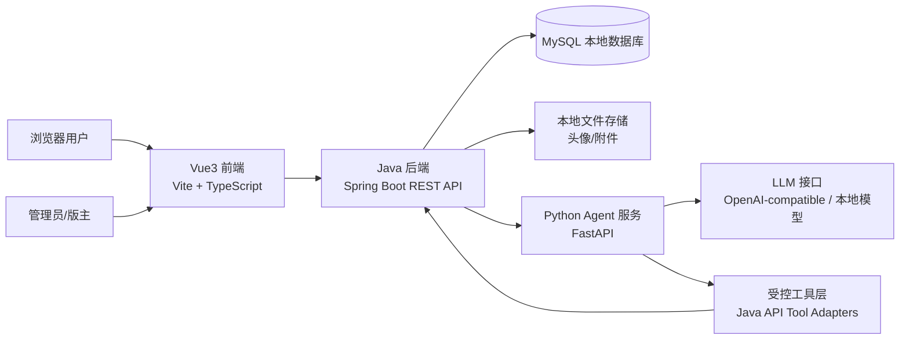

架构原则：

- 前端只调用 Java 后端，不直接调用 MySQL。
- Python Agent 默认不直接写 MySQL。它需要业务数据时，通过 Java 提供的工具接口读取或提交建议。
- Java 后端是权限、事务和审计的中心。
- AI 相关调用可以失败，但不能拖垮论坛基础功能。
- 数据库先用 MySQL 本地单库，表结构保留后续迁移空间。

## 6. 服务边界

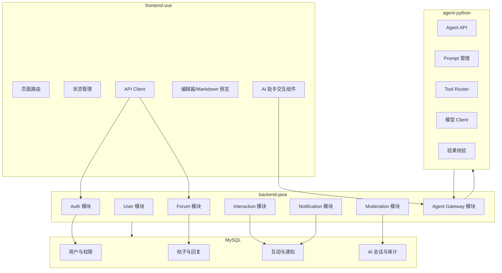

## 7. 推荐技术栈

### 7.1 Java 后端

- JDK：17 或 21。
- 框架：Spring Boot 3.x。
- Web：Spring MVC。
- 权限：Spring Security + JWT。
- ORM：MyBatis-Plus，适合本地项目快速落地，SQL 可控。
- 校验：Jakarta Validation。
- 文档：springdoc-openapi。
- 数据库迁移：Flyway。
- 测试：JUnit 5 + Testcontainers 或本地 MySQL 测试库。

### 7.2 Vue3 前端

- Vue 3 + Vite + TypeScript。
- 路由：Vue Router。
- 状态管理：Pinia。
- 请求：Axios。
- UI：Element Plus。
- Markdown 编辑：ByteMD、md-editor-v3 或同类组件。
- 测试：Vitest + Playwright。

### 7.3 Python Agent

- Python 3.11+。
- Web：FastAPI。
- HTTP：httpx。
- 数据模型：Pydantic。
- Agent 编排：可先用轻量自定义流程，后续再接 LangGraph 这类图式编排库。
- 模型接口：OpenAI-compatible Chat Completions 风格，方便接云模型或本地模型。
- 测试：pytest。

### 7.4 数据库

- MySQL 8.x。
- 字符集：utf8mb4。
- 排序规则：utf8mb4_0900_ai_ci 或 utf8mb4_general_ci。
- 本地开发可配 docker-compose，也可连接本机已安装 MySQL。

## 8. 数据模型设计

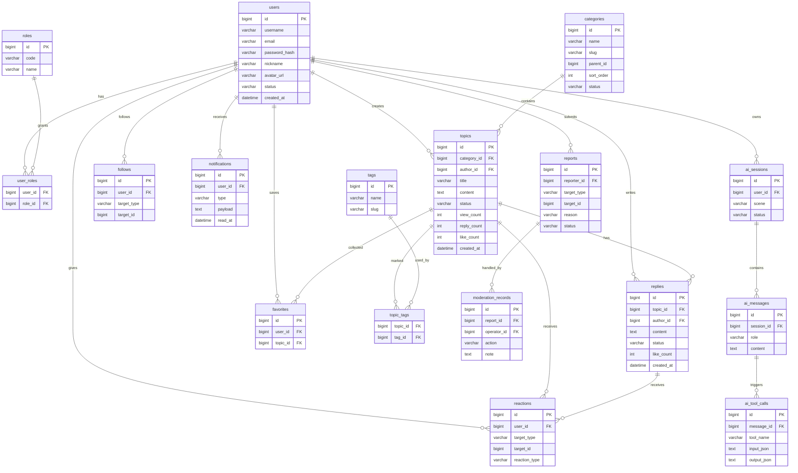

### 8.1 表设计说明

| 表 | 用途 | 第一阶段重点 |
| --- | --- | --- |
| users | 用户账号和资料 | 登录、发帖、权限判断 |
| roles / user_roles | 角色关系 | 管理员、版主、用户 |
| categories | 论坛板块 | 首页导航、权限扩展 |
| topics | 主题帖 | 论坛核心内容 |
| replies | 回复 | 帖子讨论 |
| tags / topic_tags | 标签 | 内容组织、AI 推荐标签 |
| reactions | 点赞等互动 | 支持帖子和回复 |
| favorites | 收藏 | 用户个人内容库 |
| follows | 关注 | 关注板块或用户，MVP 先做关注板块 |
| notifications | 通知 | 回复、点赞、系统消息 |
| reports | 举报 | 用户提交治理线索 |
| moderation_records | 治理记录 | 版主和管理员审计 |
| ai_sessions / ai_messages / ai_tool_calls | AI 会话记录 | 复盘、调试、审计 |

统一字段建议：

- 主键：`BIGINT`，雪花 ID 或数据库自增二选一。第一阶段可用自增，后续再替换。
- 时间：`created_at`、`updated_at`、`deleted_at`。
- 软删除：业务主表建议保留 `deleted_at`。
- 状态字段：使用短字符串，比如 `PUBLISHED`、`HIDDEN`、`LOCKED`。
- JSON 字段：MySQL 可用 `JSON` 类型保存通知 payload、AI tool 参数等结构化扩展内容。

## 9. API 设计基调

### 9.1 通用返回格式

```json
{
  "code": "OK",
  "message": "success",
  "data": {},
  "traceId": "req-20260804-000001"
}
```

分页格式：

```json
{
  "items": [],
  "page": 1,
  "pageSize": 20,
  "total": 128
}
```

错误码建议：

| code | 场景 |
| --- | --- |
| OK | 成功 |
| BAD_REQUEST | 参数不合法 |
| UNAUTHORIZED | 未登录或登录失效 |
| FORBIDDEN | 无权限 |
| NOT_FOUND | 资源不存在 |
| CONFLICT | 状态冲突或重复操作 |
| RATE_LIMITED | 请求过快 |
| AGENT_UNAVAILABLE | AI 服务不可用 |
| INTERNAL_ERROR | 系统异常 |

### 9.2 REST 接口草案

| 方法 | 路径 | 说明 |
| --- | --- | --- |
| POST | `/api/auth/register` | 注册 |
| POST | `/api/auth/login` | 登录 |
| GET | `/api/users/me` | 当前用户 |
| PATCH | `/api/users/me` | 修改资料 |
| GET | `/api/categories` | 板块列表 |
| POST | `/api/admin/categories` | 创建板块 |
| GET | `/api/topics` | 帖子列表 |
| POST | `/api/topics` | 发布帖子 |
| GET | `/api/topics/{id}` | 帖子详情 |
| PATCH | `/api/topics/{id}` | 编辑帖子 |
| DELETE | `/api/topics/{id}` | 删除帖子 |
| POST | `/api/topics/{id}/replies` | 回复帖子 |
| GET | `/api/topics/{id}/replies` | 回复列表 |
| POST | `/api/topics/{id}/like` | 点赞帖子 |
| DELETE | `/api/topics/{id}/like` | 取消点赞 |
| POST | `/api/topics/{id}/favorite` | 收藏帖子 |
| DELETE | `/api/topics/{id}/favorite` | 取消收藏 |
| GET | `/api/notifications` | 通知列表 |
| POST | `/api/reports` | 举报内容 |
| GET | `/api/admin/reports` | 举报列表 |
| POST | `/api/admin/reports/{id}/handle` | 处理举报 |
| POST | `/api/agent/chat` | 站内 AI 问答 |
| POST | `/api/agent/polish` | 发帖润色 |
| POST | `/api/agent/suggest-tags` | 标签推荐 |
| POST | `/api/agent/summarize-topic` | 帖子摘要 |
| POST | `/api/agent/moderation-check` | 内容风险提示 |

Java 对外提供 `/api/agent/*`，内部再转发到 Python Agent。这样前端不用感知 Python 服务地址，也不会绕开 Java 的鉴权和限流。

## 10. AI Agent 设计

### 10.1 Agent 定位

Agent 是论坛的辅助服务，不是数据库管理员。它可以读授权范围内的帖子、归纳内容、生成文本建议、返回风险提示。凡是会改变业务状态的动作，都由 Java 后端二次确认并落库。

### 10.2 Agent 服务结构

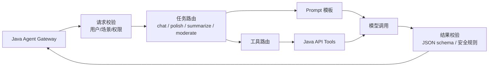

### 10.3 Python Agent 接口

| 方法 | 路径 | 说明 |
| --- | --- | --- |
| POST | `/agent/chat` | 多轮问答 |
| POST | `/agent/polish` | 润色标题和正文 |
| POST | `/agent/suggest-tags` | 推荐标签 |
| POST | `/agent/summarize-topic` | 生成帖子摘要 |
| POST | `/agent/moderation-check` | 内容风险提示 |
| GET | `/health` | 健康检查 |

请求头：

- `X-Internal-Token`：Java 与 Python 之间的内部令牌。
- `X-Trace-Id`：请求链路追踪。

### 10.4 Agent 工具清单

Python Agent 可用工具不要直接连数据库，先调用 Java 内部接口：

| 工具名 | 来源 | 用途 | 权限要求 |
| --- | --- | --- | --- |
| `search_topics` | Java API | 搜索公开或用户有权访问的帖子 | 当前用户 |
| `get_topic_context` | Java API | 获取帖子、作者、回复摘要 | 当前用户 |
| `list_categories` | Java API | 获取板块和标签候选 | 登录用户或游客 |
| `get_user_profile` | Java API | 获取当前用户公开资料 | 当前用户 |
| `create_ai_draft` | Java API | 保存 AI 草稿，不直接发布 | 当前用户 |
| `record_moderation_hint` | Java API | 记录 AI 风险提示 | 版主/管理员或发布前检查 |

### 10.5 AI 调用流程

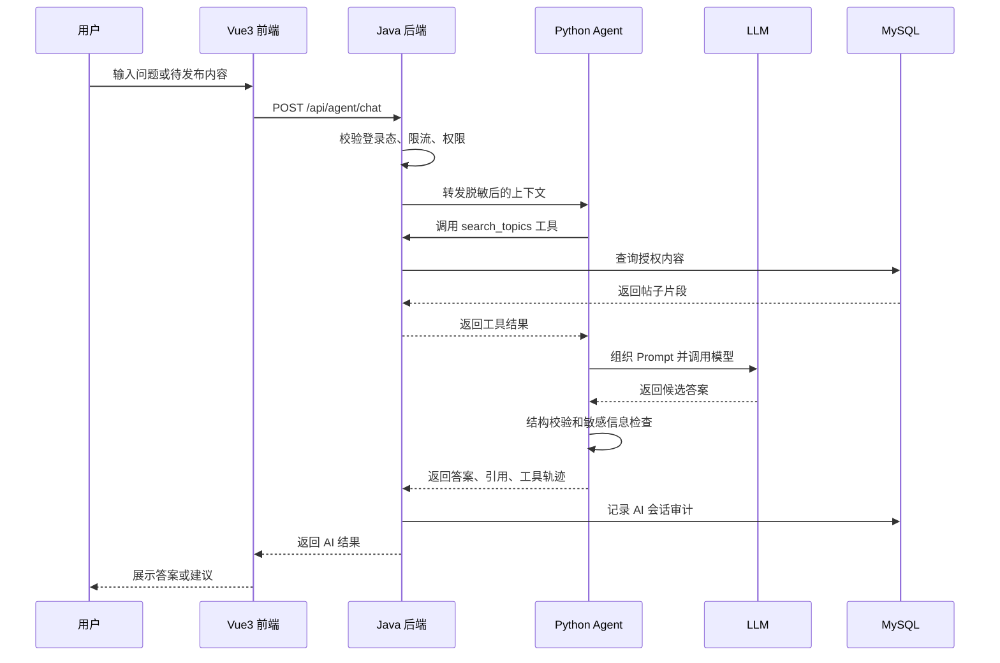

### 10.6 Prompt 基线

Agent 的系统约束建议写入 Python 项目独立文件：

- 回答必须基于可见帖子、用户输入和明确系统规则。
- 无法确认时说明信息不足，给出可操作的下一步。
- 不输出后台令牌、数据库结构细节和他人隐私信息。
- 不直接承诺已经发布、删除、封禁，只能说“可以为你生成草稿/建议”。
- 涉及治理判断时输出风险等级、依据片段、建议动作。
- 所有工具调用入参和输出都记录 trace，便于定位问题。

## 11. 前端信息架构

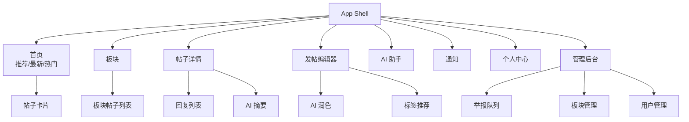

页面基调：

- 首页优先展示内容，不做营销式落地页。
- 帖子列表要紧凑，便于扫描标题、板块、作者、回复数和最新回复时间。
- 发帖编辑器是核心页面，AI 操作放在编辑区旁边或底部抽屉中，避免打断写作。
- 管理后台要朴素清晰，重点是列表筛选、批量操作和处理记录。
- 移动端先保证浏览、发帖和回帖可用，复杂管理功能可在桌面端优先完善。

## 12. 后端模块结构

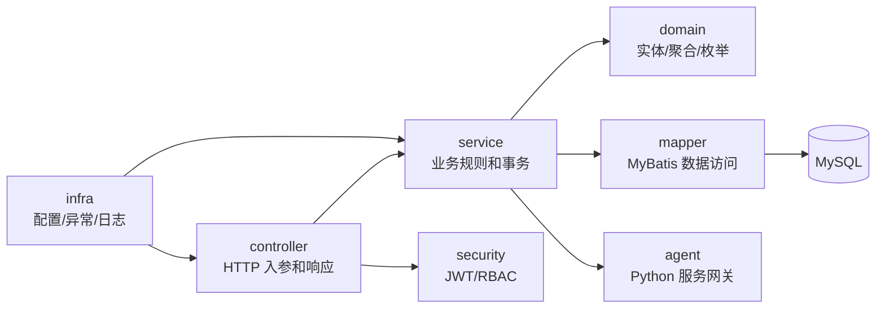

建议 Java 包划分：

```text
backend-java/
  src/main/java/com/threadmind/forum/
    ThreadMindApplication.java
    common/
      api/
      config/
      exception/
      id/
      security/
    auth/
      controller/
      service/
      dto/
    user/
      controller/
      service/
      mapper/
      entity/
      dto/
    forum/
      category/
      topic/
      reply/
      tag/
    interaction/
      reaction/
      favorite/
      follow/
    notification/
    moderation/
    agent/
      controller/
      service/
      client/
      dto/
    admin/
  src/main/resources/
    application.yml
    db/migration/
```

## 13. 仓库结构建议

```text
vibecoding/
  README.md
  PRODUCT.md
  docs/
    forum-ai-project-spec.md
    api-contracts.md
    database-design.md
    adr/
      0001-service-boundaries.md
  backend-java/
    pom.xml
    src/main/java/com/threadmind/forum/
    src/main/resources/
    src/test/java/com/threadmind/forum/
  frontend-vue/
    package.json
    index.html
    src/
      app/
      pages/
      components/
      features/
      router/
      stores/
      api/
      styles/
  agent-python/
    pyproject.toml
    app/
      main.py
      api/
      core/
      agents/
      prompts/
      tools/
      schemas/
      clients/
    tests/
  infra/
    docker-compose.yml
    mysql/
      init/
  scripts/
    dev.ps1
    check.ps1
```

结构约定：

- `docs/` 保存决策，不把重要约定藏在聊天记录里。
- `backend-java/` 是主业务服务。
- `frontend-vue/` 是浏览器端应用。
- `agent-python/` 是 AI 能力服务。
- `infra/` 保存本地 MySQL 和未来可选服务。
- `scripts/` 保存常用启动和检查脚本。

## 14. 本地开发拓扑

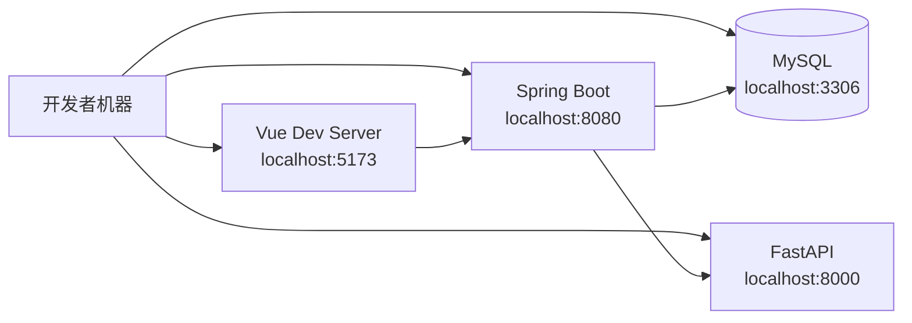

环境变量草案：

| 变量 | 所属服务 | 说明 |
| --- | --- | --- |
| `MYSQL_HOST` | Java | MySQL 地址 |
| `MYSQL_PORT` | Java | MySQL 端口 |
| `MYSQL_DATABASE` | Java | 数据库名 |
| `MYSQL_USERNAME` | Java | 数据库用户 |
| `MYSQL_PASSWORD` | Java | 数据库密码 |
| `JWT_SECRET` | Java | JWT 签名密钥 |
| `AGENT_BASE_URL` | Java | Python Agent 地址 |
| `AGENT_INTERNAL_TOKEN` | Java/Python | 内部服务令牌 |
| `MODEL_BASE_URL` | Python | 模型服务地址 |
| `MODEL_API_KEY` | Python | 模型 API Key |
| `MODEL_NAME` | Python | 默认模型名 |
| `VITE_API_BASE_URL` | Vue | Java API 地址 |

端口约定：

- Vue3：`5173`
- Java：`8080`
- Python Agent：`8000`
- MySQL：`3306`

## 15. 关键业务流程

### 15.1 发帖流程

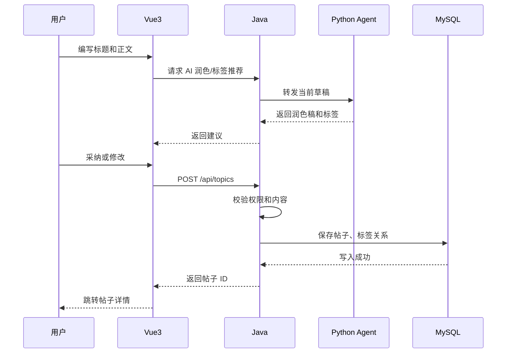

### 15.2 回复通知流程

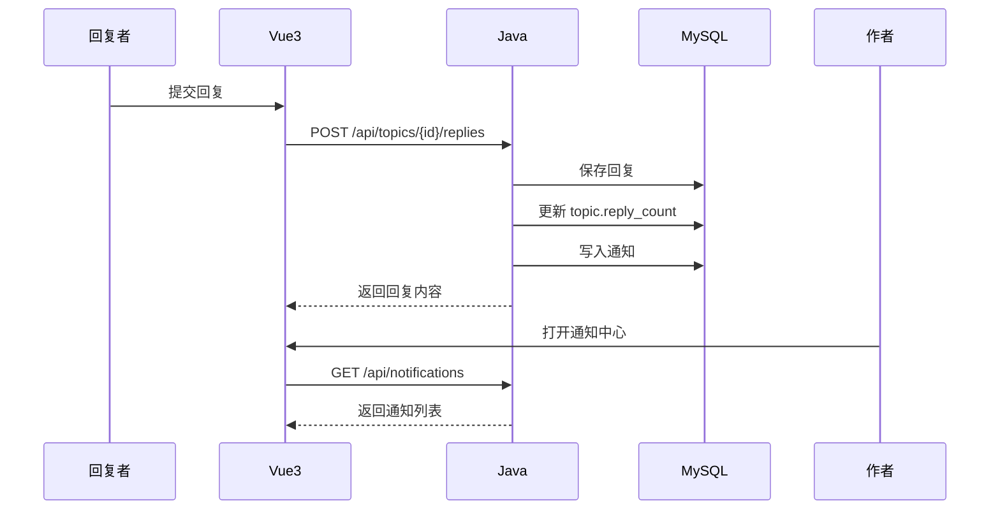

### 15.3 举报处理流程

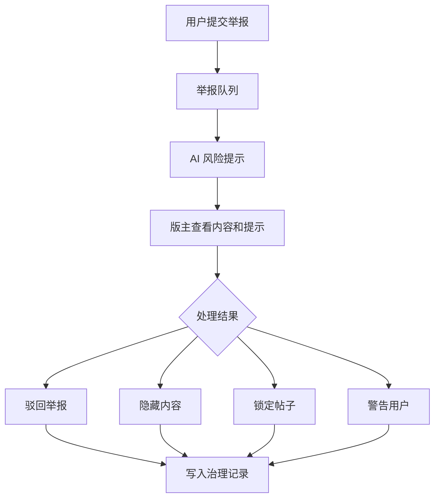

## 16. 权限规则

基础规则：

- 游客只能查看公开内容。
- 用户只能编辑和删除自己的草稿或已发布帖子；已锁定帖子不可编辑。
- 用户不能删除他人回复。
- 版主只能管理自己负责板块内的内容。
- 管理员可以管理全站内容和用户状态。
- AI 返回的建议不等于系统操作。任何发布、删除、隐藏、封禁都必须经过 Java 后端接口和权限校验。

权限实现建议：

- Java 使用 RBAC：`ROLE_USER`、`ROLE_MODERATOR`、`ROLE_ADMIN`。
- 板块级版主权限单独建表，如 `category_moderators`，第二阶段实现。
- Controller 层做登录校验，Service 层做资源归属和状态校验。
- 所有管理操作记录 operator、目标资源、动作、备注和 traceId。

## 17. 安全与可靠性

第一阶段就要保留这些底线：

- 密码只保存哈希，建议 BCrypt。
- 所有写接口校验登录态和 CSRF 风险；如果只用 JWT，也要注意前端存储策略。
- Markdown 内容渲染前做 XSS 清理。
- SQL 通过 ORM 参数绑定，不拼接用户输入。
- 文件上传限制类型、大小和存储路径；MVP 可先不做附件。
- 登录、发帖、AI 调用加基础限流。
- Agent 输入做脱敏，避免把内部 token、管理员备注、未授权内容发给模型。
- AI 输出必须经过长度、格式和敏感内容检查。
- Java 调 Python 设置超时，失败时返回可读错误，不影响论坛主体流程。

## 18. 日志与审计

建议统一使用 `traceId`：

- 前端每次请求接收后端返回的 `traceId`，错误反馈时可展示。
- Java 对登录、发帖、删除、治理、AI 调用记录结构化日志。
- Python 对 prompt 模板版本、工具调用、模型名、耗时、错误类型做记录。
- MySQL 保存 AI 会话、工具调用输入输出的摘要或脱敏内容，避免把敏感原文无限期堆在库里。

## 19. 测试策略

Java：

- Service 单元测试：发帖、回帖、权限、举报处理。
- Controller 集成测试：登录态、参数校验、错误码。
- 数据库迁移测试：Flyway 脚本能从空库跑通。

Vue：

- 组件测试：帖子卡片、编辑器、通知列表。
- 页面流程测试：登录、发帖、回复、AI 润色。
- API Client 测试：错误码和登录失效处理。

Python：

- Agent 路由测试：不同 scene 命中正确流程。
- Tool 调用测试：Java API 异常、超时、空结果。
- 输出校验测试：模型返回非 JSON、超长文本、缺字段。

端到端：

- 本地启动四个服务后跑一条完整链路：注册、登录、发帖、AI 摘要、回复、通知。

## 20. 里程碑

| 阶段 | 目标 | 交付物 |
| --- | --- | --- |
| M0 | 项目基线 | 说明书、结构图、仓库目录、环境变量约定 |
| M1 | 工程脚手架 | Java/Vue/Python 三个服务可启动，MySQL 可连接 |
| M2 | 账号和论坛核心 | 注册登录、板块、发帖、回帖 |
| M3 | 互动和通知 | 点赞、收藏、通知中心、热门帖子 |
| M4 | AI MVP | 润色、标签推荐、摘要、站内问答 |
| M5 | 管理后台 | 举报、隐藏、锁定、用户状态 |
| M6 | 质量收口 | 测试、文档、错误处理、部署脚本 |

## 21. 第一阶段验收标准

MVP 完成时至少满足：

- 本地能从空数据库初始化并启动。
- 普通用户能完成注册、登录、发帖、回帖、点赞、收藏。
- 管理员能看到帖子和举报记录，并能隐藏或恢复帖子。
- 发帖页能调用 AI 润色和标签推荐。
- 帖子详情页能生成 AI 摘要。
- AI 问答能基于站内帖子返回答案，并标明引用的帖子。
- Java 后端、Python Agent、Vue 前端都有基础测试。
- README 写清楚启动方式和常见问题。

## 22. 后续扩展方向

- 加 Redis：缓存热门帖子、登录限流、通知未读数。
- 加全文检索：MySQL FULLTEXT 起步，后续可接 Elasticsearch 或 Meilisearch。
- 加向量检索：把帖子摘要、规则文档、精品回复向量化，提升 AI 问答质量。
- 加 WebSocket：通知实时推送。
- 加 OAuth：GitHub、Google 等第三方登录。
- 加内容推荐：基于板块关注、标签兴趣和浏览历史推荐帖子。
- 加运营看板：新增用户、活跃用户、发帖量、AI 使用次数、举报处理效率。

## 23. 开发纪律

- 先提交数据库迁移，再写依赖该字段的业务代码。
- 前后端接口字段以 `docs/api-contracts.md` 或 OpenAPI 为准，避免口头约定。
- Python Agent 的输出必须有 schema，Java 后端不要直接信任自然语言结果。
- 每个跨服务调用都设置超时、错误码和 traceId。
- 新增重要规则时补 ADR，写清楚为什么这样定。
- 不把 API Key、数据库密码、JWT 密钥提交到仓库。

## 24. 下一步建议

接下来可以按这个顺序进入开发：

1. 建立三端目录和本地 `docker-compose.yml`。
2. 创建 MySQL 数据库迁移脚本。
3. 搭 Java Spring Boot 基础项目，先跑通 `/health` 和数据库连接。
4. 搭 Vue3 项目，先做论坛首页、登录页、帖子详情页静态版。
5. 搭 Python FastAPI Agent，先跑通 `/health` 和一个 mock 模型响应。
6. 接通 Java 到 Python 的 `/api/agent/polish`。
7. 再补发帖、回帖、标签、摘要这些核心链路。

## 25. 当前仓库基线

本仓库按 M1 目标先落三端骨架：

- `backend-java/`：Spring Boot 入口、通用响应、健康检查、账号接口、论坛演示接口、Agent Gateway、Flyway 初始建表脚本。
- `agent-python/`：FastAPI 入口、内部令牌校验、Agent 路由、模型客户端、Java 工具客户端、无模型 Key 时的稳定 mock 响应。
- `frontend-vue/`：Vue3 + Vite + TypeScript 页面骨架，包括首页、帖子详情、发帖编辑器、AI 助手、管理台和登录页。
- `infra/`：本地 MySQL docker-compose。
- `scripts/`：本地启动和检查脚本。

细化契约见 `docs/api-contracts.md`，数据库设计见 `docs/database-design.md`，服务边界决策见 `docs/adr/0001-service-boundaries.md`。

## 26. 模块设计说明

后续开发以 `docs/modules/` 下的模块说明为准。每份模块说明都写清楚功能边界、设计思路、设计理念和后续替换点，避免只留下“代码能跑但没人知道为什么这样写”的工程状态。

当前模块：

- 账号与用户：`docs/modules/auth-user.md`
- 论坛内容：`docs/modules/forum-content.md`
- 互动与通知：`docs/modules/interaction-notification.md`
- 治理：`docs/modules/moderation.md`
- AI Agent：`docs/modules/agent.md`
- 前端体验：`docs/modules/frontend.md`
